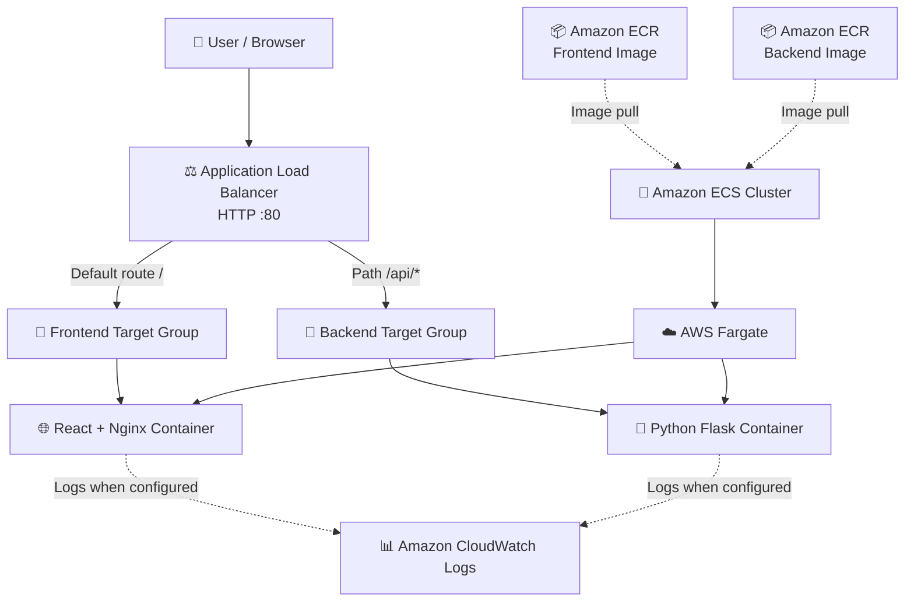
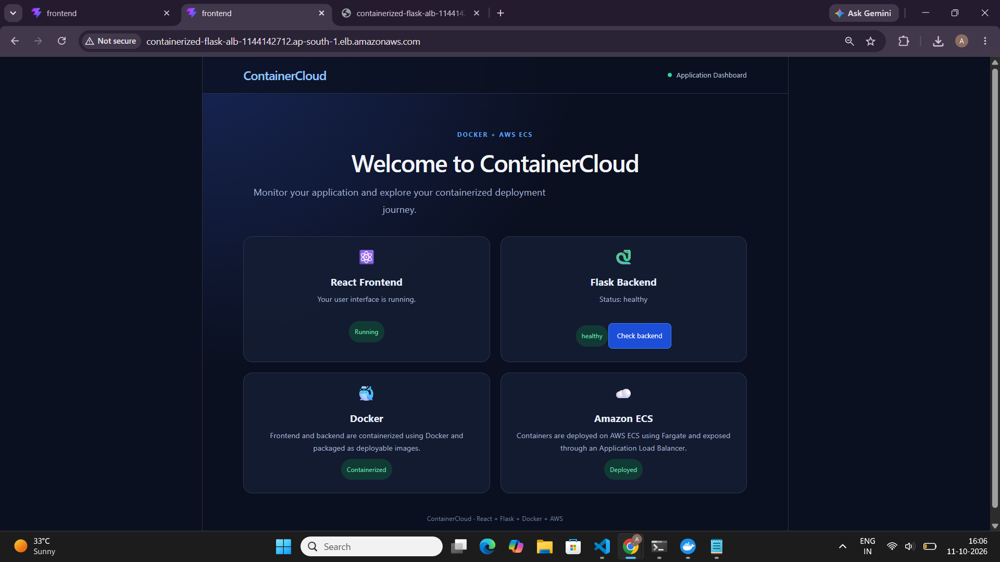
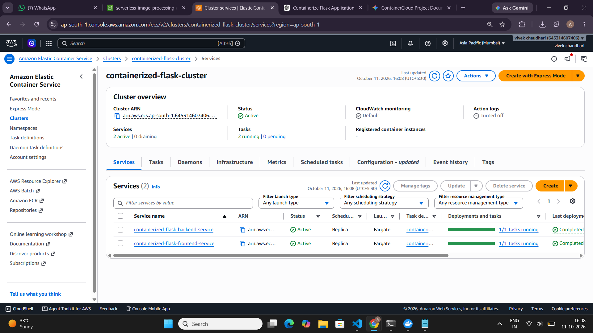
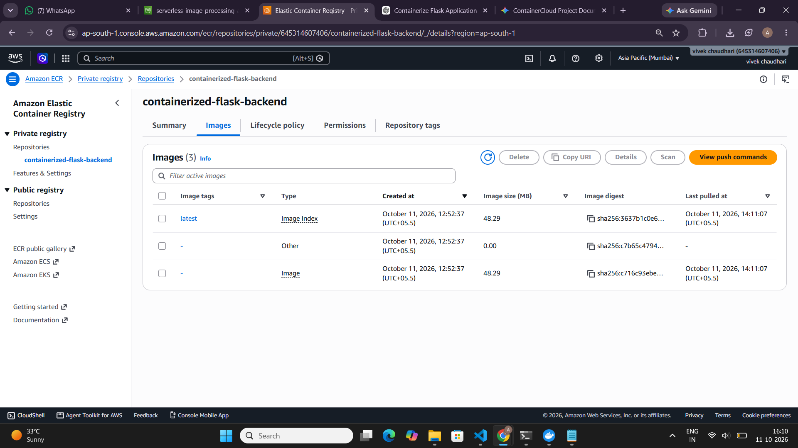
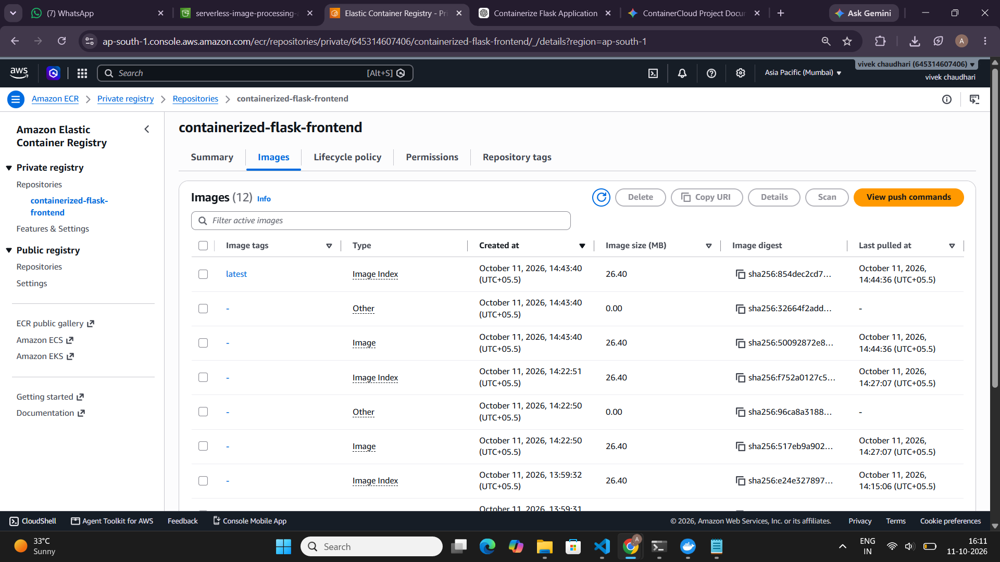
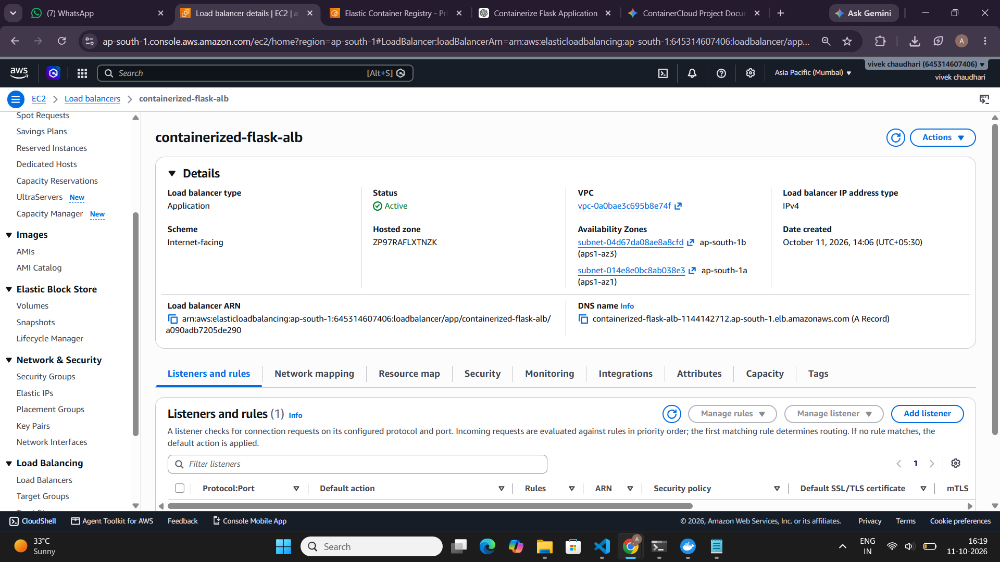
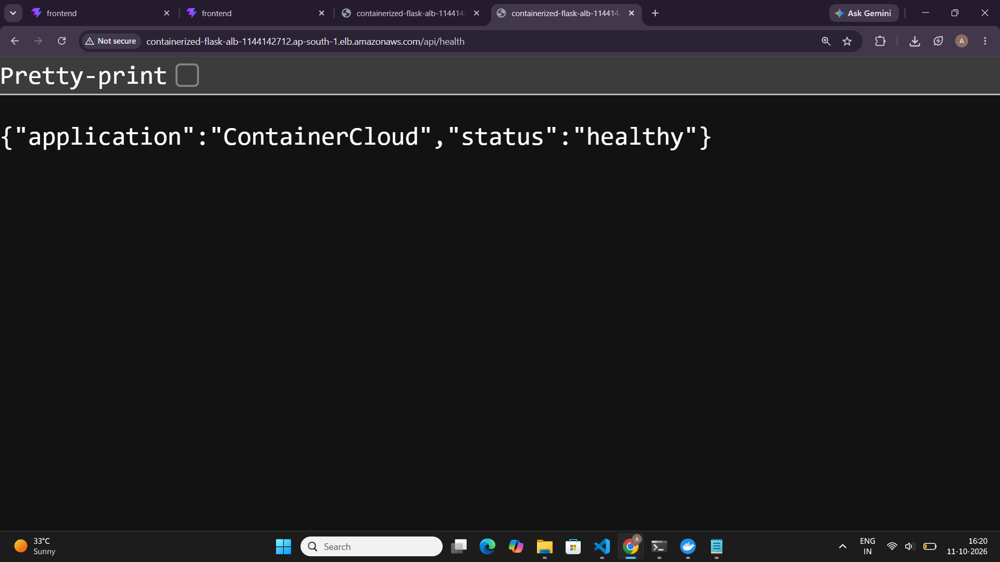

# ☁️ ContainerCloud — Containerized Web Application on AWS

A containerized web application built with **React, Python Flask, and Docker**, deployed on **Amazon ECS using AWS Fargate**. Amazon ECR stores the Docker images, while an Application Load Balancer routes incoming traffic to the frontend and backend services.

The project demonstrates containerization, cloud deployment, API routing, health checks, and application monitoring using AWS services.

---

## 📌 Table of Contents

* [Project Overview](#-project-overview)
* [Features](#-features)
* [Technology Stack](#-technology-stack)
* [Architecture Diagram](#️-architecture-diagram)
* [AWS Resources](#️-aws-resources)
* [Project Structure](#-project-structure)
* [Application Endpoints](#-application-endpoints)
* [Screenshots](#-screenshots)
* [Prerequisites](#-prerequisites)
* [Run Locally with Docker Compose](#-run-locally-with-docker-compose)
* [Build and Push Images to ECR](#-build-and-push-images-to-ecr)
* [Deploy to Amazon ECS](#-deploy-to-amazon-ecs)
* [Monitoring and Troubleshooting](#-monitoring-and-troubleshooting)
* [Security Considerations](#-security-considerations)
* [Learning Outcomes](#-learning-outcomes)
* [Future Improvements](#-future-improvements)

---

## 🎯 Project Overview

ContainerCloud is a web application designed to demonstrate how a frontend and backend can be packaged into separate Docker containers and deployed on AWS.

The frontend uses React and Vite, with Nginx serving the production build. The backend uses Python Flask to expose REST API endpoints.

Amazon ECS manages the containerized services, AWS Fargate provides the compute environment, Amazon ECR stores the images, and an Application Load Balancer acts as the common entry point.

### Project Objectives

* 🐳 Containerize the frontend and backend using Docker.
* 📦 Store Docker images in Amazon ECR.
* ☁️ Deploy containers using Amazon ECS and AWS Fargate.
* ⚖️ Route web and API requests through an Application Load Balancer.
* 🩺 Implement and test a backend health-check endpoint.
* 📊 Learn how to monitor and troubleshoot a containerized AWS application.

---

## ✨ Features

* 🌐 React-based web dashboard.
* 🐍 Python Flask backend API.
* 🐳 Separate Docker images for frontend and backend.
* 📦 Private image repositories in Amazon ECR.
* ☁️ Container orchestration using Amazon ECS.
* ⚙️ Serverless container compute using AWS Fargate.
* ⚖️ Path-based routing using an Application Load Balancer.
* 🩺 Backend health-check API returning JSON.
* 📊 Centralized container logging through CloudWatch Logs when configured.
* 🔄 Independent frontend and backend deployments.

---

## 🛠️ Technology Stack

| Category                | Technology                          |
| ----------------------- | ----------------------------------- |
| Frontend                | React, Vite                         |
| Web Server              | Nginx                               |
| Backend                 | Python, Flask                       |
| Containerization        | Docker                              |
| Container Registry      | Amazon ECR                          |
| Container Orchestration | Amazon ECS                          |
| Compute                 | AWS Fargate                         |
| Traffic Routing         | Application Load Balancer           |
| Monitoring              | Amazon CloudWatch                   |
| Cloud Platform          | AWS                                 |
| Region                  | Asia Pacific (Mumbai), `ap-south-1` |

---

## 🏗️ Architecture Diagram



### 🔄 Request Flow

**Loading the dashboard**

1. The user opens the Application Load Balancer URL.
2. The ALB receives the HTTP request.
3. The default route forwards the request to the frontend target group.
4. Nginx serves the React production assets.
5. The browser renders the dashboard.

**Calling the backend API**

1. The browser requests `/api/health`.
2. The ALB matches the `/api/*` listener rule.
3. The request reaches the backend target group.
4. Flask processes the request and returns JSON.
5. The response passes back through the ALB to the browser.

**Deployment flow**

Source Code → Docker Build → Amazon ECR → Amazon ECS on AWS Fargate → Application Load Balancer

---

## ☁️ AWS Resources

The following are the project resource names used during implementation.

| AWS Resource              | Name / Configuration                   |
| ------------------------- | -------------------------------------- |
| AWS Region                | `ap-south-1`                           |
| ECS Cluster               | `containerized-flask-cluster`          |
| Frontend ECS Service      | `containerized-flask-frontend-service` |
| Backend ECS Service       | `containerized-flask-backend-service`  |
| Frontend ECR Repository   | `containerized-flask-frontend`         |
| Backend ECR Repository    | `containerized-flask-backend`          |
| Application Load Balancer | `containerized-flask-alb`              |
| CloudWatch Log Group      | `/ecs/containerized-flask-app`         |

*Verify that these resources still exist and that the current configuration matches this documentation.*

---

## 📁 Project Structure

```text
containerized-flask-app/
│
├── .env.example
│
├── aws/
│
├── backend/
│   ├── app.py
│   ├── requirements.txt
│   └── Dockerfile
│
├── docker/
│
├── docs/
│   ├── architecture.md
│   └── screenshots/
│       ├── application-dashboard.png
│       ├── backend-health.png
│       ├── ecr-repositories-backend.png
│       ├── ECR-Repositories-Frontend.png
│       ├── ecs-services.png
│       └── load-balancer.png
│
├── frontend/
│   ├── src/
│   ├── public/
│   ├── package.json
│   ├── nginx.conf
│   ├── Dockerfile
│   └── ...
│
├── backend-task-definition.json
├── frontend-task-definition.json
├── docker-compose.yml
└── README.md
```

*This is a logical overview. Keep it aligned with the actual files and folders in your repository.*

---

## 🔗 Application Endpoints

### 🌐 Frontend Dashboard

[Open ContainerCloud Dashboard](http://containerized-flask-alb-1144142712.ap-south-1.elb.amazonaws.com/)

### 🩺 Backend Health Check

[Check Backend Health](http://containerized-flask-alb-1144142712.ap-south-1.elb.amazonaws.com/api/health)

Expected response:

```json
{
  "application": "ContainerCloud",
  "status": "healthy"
}
```

The endpoints use HTTP for the current demonstration. Configure HTTPS before using the application for production workloads.

---

## 📸 Screenshots

### 🌐 Application Dashboard



### 🐳 Amazon ECS Services



### 📦 Amazon ECR — Backend Repository



### 📦 Amazon ECR — Frontend Repository



### ⚖️ Application Load Balancer



### 🩺 Backend Health Check



---

## 📋 Prerequisites

Install or configure the following before running the project:

* [Docker Desktop](https://www.docker.com/products/docker-desktop/)
* [Git](https://git-scm.com/)
* [AWS CLI](https://docs.aws.amazon.com/cli/latest/userguide/getting-started-install.html)
* An AWS account with appropriate permissions for ECR, ECS, and related services.

Verify the installations:

```cmd
docker --version
git --version
aws --version
```

Verify the AWS identity and region:

```cmd
aws sts get-caller-identity
aws configure get region
```

The configured region for this project is `ap-south-1`.

---

## 🐳 Run Locally with Docker Compose

From the project root, make sure Docker Desktop is running.

Build and start the application:

```cmd
docker compose up --build -d
```

List the running containers:

```cmd
docker compose ps
```

View the container logs:

```cmd
docker compose logs
```

To stop the application:

```cmd
docker compose down
```

Open the local URL configured in `docker-compose.yml`. For a typical configuration, the frontend may be available at `http://localhost:80`, but confirm the published ports in your Compose file.

---

## 📦 Build and Push Images to ECR

### 1. Authenticate Docker with Amazon ECR

The following commands use the project account and Mumbai region. Replace the account ID if your AWS account differs.

```cmd
aws ecr get-login-password --region ap-south-1 | docker login --username AWS --password-stdin 645314607406.dkr.ecr.ap-south-1.amazonaws.com
```

### 2. Build the Frontend Image

Run from the project root:

```cmd
docker build -t containerized-flask-frontend:latest ./frontend
```

Tag the image:

```cmd
docker tag containerized-flask-frontend:latest 645314607406.dkr.ecr.ap-south-1.amazonaws.com/containerized-flask-frontend:latest
```

Push it to ECR:

```cmd
docker push 645314607406.dkr.ecr.ap-south-1.amazonaws.com/containerized-flask-frontend:latest
```

### 3. Build the Backend Image

```cmd
docker build -t containerized-flask-backend:latest ./backend
```

Tag the image:

```cmd
docker tag containerized-flask-backend:latest 645314607406.dkr.ecr.ap-south-1.amazonaws.com/containerized-flask-backend:latest
```

Push it to ECR:

```cmd
docker push 645314607406.dkr.ecr.ap-south-1.amazonaws.com/containerized-flask-backend:latest
```

**Note:** These commands assume that both Dockerfiles and both ECR repositories exist at the specified locations. The `latest` tag is convenient for learning; versioned tags are preferable for repeatable deployments.

---

## 🚀 Deploy to Amazon ECS

The project uses Amazon ECS services backed by AWS Fargate.

After pushing a new image, trigger a new deployment of the relevant service:

### Frontend Service

```cmd
aws ecs update-service --cluster containerized-flask-cluster --service containerized-flask-frontend-service --force-new-deployment --region ap-south-1
```

### Backend Service

```cmd
aws ecs update-service --cluster containerized-flask-cluster --service containerized-flask-backend-service --force-new-deployment --region ap-south-1
```

Check the frontend service:

```cmd
aws ecs describe-services --cluster containerized-flask-cluster --services containerized-flask-frontend-service --region ap-south-1
```

Check the backend service:

```cmd
aws ecs describe-services --cluster containerized-flask-cluster --services containerized-flask-backend-service --region ap-south-1
```

### Important Deployment Note

When reusing the same image tag, such as `latest`, a forced deployment can start new tasks that pull the updated image, provided the task definition, image URI, and execution role are configured correctly.

For more controlled deployments, publish versioned image tags and update the relevant ECS task definition to reference the intended version.

---

## 📊 Monitoring and Troubleshooting

### 🩺 Check Backend Health

Open:

`http://containerized-flask-alb-1144142712.ap-south-1.elb.amazonaws.com/api/health`

Confirm that the response contains `"status": "healthy"`.

### 🐳 Check Running Containers Locally

```cmd
docker ps
```

### 📋 Check ECS Service Status

```cmd
aws ecs describe-services --cluster containerized-flask-cluster --services containerized-flask-frontend-service containerized-flask-backend-service --region ap-south-1
```

### 📊 Check CloudWatch Logs

Open the AWS Console and navigate to **CloudWatch → Logs → Log groups**.

Look for:

`/ecs/containerized-flask-app`

Log availability depends on the task definition's logging configuration and the IAM permissions assigned to the task execution role.

### 🔧 Common Problems

| Problem                       | What to Check                                                     |
| ----------------------------- | ----------------------------------------------------------------- |
| Dashboard does not load       | ALB listener, frontend target group health, Nginx configuration   |
| API returns an error          | Flask logs, backend target group health, `/api/health` endpoint   |
| ECS tasks fail to start       | ECS service events, task stopped reason, CloudWatch logs          |
| Image pull fails              | ECR repository URI, image tag, task execution role permissions    |
| Target is unhealthy           | Health-check path, port, security groups, container startup       |
| Frontend assets return errors | Vite production build, Nginx configuration, generated asset paths |

---

## 🔐 Security Considerations

* 🔒 Restrict public access to the required ALB listener ports.
* 🛡️ Use security groups to limit traffic between the ALB and ECS tasks.
* 🔑 Use IAM roles rather than hard-coded AWS credentials.
* 🔐 Never commit `.env` files, passwords, access keys, or other secrets.
* 📦 Keep ECR repositories private unless public access is intentionally required.
* 🔒 Configure HTTPS with AWS Certificate Manager for production deployments.
* 🧱 Review task networking, IAM permissions, and logging settings regularly.

---

## 🎓 Learning Outcomes

Through this project, I gained practical experience with:

* Building and packaging applications using Docker.
* Separating frontend and backend services.
* Storing container images in Amazon ECR.
* Deploying containers with Amazon ECS and AWS Fargate.
* Routing requests through an Application Load Balancer.
* Testing REST API health endpoints.
* Inspecting ECS service status and application logs.
* Documenting cloud architecture and deployment workflows.

---

## 🚀 Future Improvements

* 🔒 Add HTTPS using AWS Certificate Manager.
* ⚙️ Automate builds and deployments using GitHub Actions.
* 🏷️ Use versioned Docker image tags.
* 📈 Configure ECS service auto scaling.
* 🚨 Add CloudWatch alarms and dashboards.
* 🧪 Introduce automated unit and integration tests.
* 🏗️ Provision infrastructure using AWS CloudFormation or Terraform.
* 🛡️ Improve secrets management and production security.

---

## 👨‍💻 Author

**Vivek Chaudhari**


---
