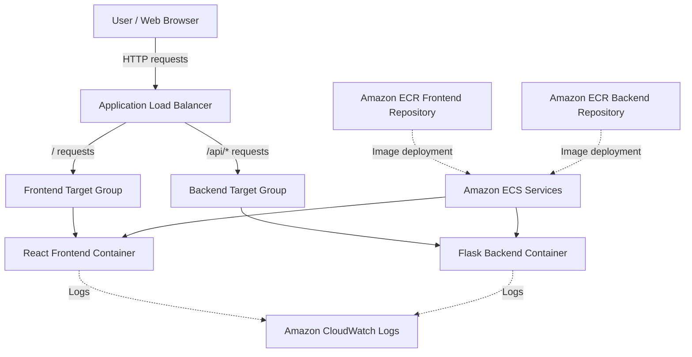

# ContainerCloud ☁️
### Containerized Flask Application on AWS ECS Fargate 🚀

**ContainerCloud** is a full-stack web application built with **React** and **Flask**, containerized using **Docker**, and deployed on **Amazon Elastic Container Service (Amazon ECS)** with **AWS Fargate**.

The project demonstrates how to build, package, deploy, and expose a frontend and backend application using AWS container services. It uses **Amazon Elastic Container Registry (Amazon ECR)** to store Docker images and an **Application Load Balancer (ALB)** to route incoming HTTP requests to the appropriate service.

The frontend provides an application dashboard that displays the status of the frontend and backend and explains the container deployment architecture.

---

## 📑 Table of Contents
1. [Project Overview](#1-project-overview-)
2. [Project Objectives](#2-project-objectives-)
3. [Features](#3-features-)
4. [Technology Stack](#4-technology-stack-)
5. [System Architecture](#5-system-architecture-)
6. [Request Flow](#6-request-flow-)
7. [AWS Resources](#7-aws-resources-)
8. [Project Directory Structure](#8-project-directory-structure-)
9. [Prerequisites](#9-prerequisites-)
10. [Run the Application Locally](#10-run-the-application-locally-)
11. [Docker Image Management](#11-docker-image-management-)
12. [AWS Deployment Workflow](#12-aws-deployment-workflow-)
13. [Application Endpoints](#13-application-endpoints-)
14. [Health Checks and Monitoring](#14-health-checks-and-monitoring-)
15. [Security Considerations](#15-security-considerations-)
16. [Troubleshooting](#16-troubleshooting-)
17. [Challenges and Learnings](#17-challenges-and-learnings-)
18. [Future Improvements](#18-future-improvements-)
19. [Screenshots](#19-screenshots-)
20. [Author](#20-author-)

---

## 1. Project Overview 🌐

Modern applications need a reliable way to package software, deploy services, and handle incoming requests. Running an application directly on a server can make deployment and environment management more complicated.

ContainerCloud explores a container-based approach by separating the frontend and backend into independent services.

The frontend is developed using **React** and built with **Vite**. The backend is developed using **Python** and **Flask** and exposes an API for application health checks.

Docker packages each component into a container image. Amazon ECR stores the images, while Amazon ECS runs the containers using AWS Fargate. An Application Load Balancer provides a common entry point and routes requests based on their URL paths.

### Main components 🧩
* **Frontend:** React application built with Vite and served using Nginx.
* **Backend:** Flask application that exposes REST API endpoints.
* **Containerization:** Docker images for the frontend and backend.
* **Image registry:** Amazon Elastic Container Registry (ECR).
* **Container orchestration:** Amazon Elastic Container Service (ECS).
* **Compute:** AWS Fargate.
* **Traffic routing:** Application Load Balancer (ALB).
* **Logging:** Amazon CloudWatch Logs.

---

## 2. Project Objectives 🎯

The main objectives of this project are:
1. ⚛️ Develop a frontend using React.
2. 🐍 Develop a backend API using Python and Flask.
3. 🐳 Containerize frontend and backend components separately.
4. 🛠️ Build and test Docker images locally.
5. 📦 Store container images in Amazon ECR.
6. 🚀 Deploy containerized services to Amazon ECS using AWS Fargate.
7. ⚖️ Configure an Application Load Balancer for incoming traffic.
8. 🔀 Route frontend requests and backend API requests to separate target groups.
9. 🩺 Configure health checks for application availability.
10. 📊 Use CloudWatch Logs to help investigate application issues.

---

## 3. Features ✨

### Application features 🖥️
* React-based application dashboard.
* Frontend status display.
* Backend health status check.
* Docker deployment information.
* AWS ECS and Fargate deployment information.
* Separate frontend and backend application services.

### Infrastructure features 🏗️
* Separate ECR repositories for frontend and backend images.
* ECS services for independently managing the frontend and backend.
* AWS Fargate for running containers without managing EC2 container hosts.
* Application Load Balancer for HTTP traffic routing.
* Path-based routing for `/` and `/api/*`.
* Health checks for the frontend and backend.
* CloudWatch log collection.

---

## 4. Technology Stack 🛠️

| Technology | Purpose |
| :--- | :--- |
| **React** | Frontend user interface |
| **Vite** | Frontend development and build tooling |
| **HTML & CSS** | Page structure and styling |
| **JavaScript** | Frontend application logic |
| **Python** | Backend programming language |
| **Flask** | Backend API framework |
| **Docker** | Application containerization |
| **Docker Compose** | Local multi-container development |
| **Amazon ECR** | Docker image storage |
| **Amazon ECS** | Container orchestration |
| **AWS Fargate** | Managed container compute |
| **Application Load Balancer** | HTTP traffic distribution and routing |
| **Amazon CloudWatch Logs** | Container log collection |
| **AWS CLI** | AWS resource inspection and management |

---

## 5. System Architecture 🏛️

### High-level architecture 📐


### Architecture explanation 💡
1. **User:** The user accesses the application using a web browser and the public DNS name of the Application Load Balancer.
2. **Application Load Balancer:** The ALB provides the application's HTTP entry point. Its listener rules forward requests to different target groups according to their paths.
3. **Frontend service:** The frontend service runs the React application. The production frontend build is served through Nginx inside a Docker container.
4. **Backend service:** The backend service runs the Flask application. It provides API endpoints, including a health-check endpoint.
5. **Amazon ECR:** ECR stores the Docker images that ECS tasks use when starting containers.
6. **Amazon ECS and AWS Fargate:** ECS manages the frontend and backend services. Fargate supplies the container compute capacity, so there is no need to manage the underlying EC2 container hosts.
7. **Amazon CloudWatch Logs:** CloudWatch Logs provides a centralized location for reviewing application container logs and diagnosing startup or runtime errors.

> ⚠️ **Important architecture note:** The frontend and backend are separate ECS services. The exact networking configuration, task counts, target group names, security group rules, and deployment settings should be confirmed from the current AWS configuration.

---

## 6. Request Flow 🔄

### Frontend request 🌐
1. A user opens the ALB URL.
2. The ALB receives the HTTP request.
3. The listener forwards the request to the frontend target group.
4. The frontend container's Nginx server serves the React application.
5. The browser renders the dashboard.

### Backend API request 🔌
1. The browser or frontend requests an API path, such as `/api/health`.
2. The ALB evaluates its listener rules.
3. The `/api/*` rule forwards the request to the backend target group.
4. The Flask application processes the request.
5. The API response is returned to the client through the ALB.

### Container image deployment 📦
1. Build the frontend and backend Docker images.
2. Authenticate Docker with Amazon ECR.
3. Tag each image with its ECR repository URI.
4. Push the images to ECR.
5. Configure the ECS task definitions to reference the images.
6. Deploy new task revisions or force a service deployment as appropriate.
7. Confirm that the new tasks are running and the ALB health checks pass.

---

## 7. AWS Resources ☁️

The following resource names correspond to the current project configuration.

| Resource | Name / Value |
| :--- | :--- |
| **AWS Region** | `ap-south-1` |
| **ECS Cluster** | `containerized-flask-cluster` |
| **Frontend ECS Service** | `containerized-flask-frontend-service` |
| **Backend ECS Service** | `containerized-flask-backend-service` |
| **Frontend ECR Repository** | `containerized-flask-frontend` |
| **Backend ECR Repository** | `containerized-flask-backend` |
| **CloudWatch Log Group** | `/ecs/containerized-flask-app` |
| **Frontend Task Definition Family** | `containerized-flask-frontend` |
| **Backend Task Definition Family** | `containerized-flask-backend` |

### ECR image locations 🏷️
* **Frontend:** `645314607406.dkr.ecr.ap-south-1.amazonaws.com/containerized-flask-frontend:latest`
* **Backend:** `645314607406.dkr.ecr.ap-south-1.amazonaws.com/containerized-flask-backend:latest`

> *Note:* These URIs identify the current image repositories. The `latest` tag is mutable, so production deployments should preferably use unique version tags or image digests.

### Application Load Balancer ⚖️
**Public application URL:**  
`http://containerized-flask-alb-1144142712.ap-south-1.elb.amazonaws.com/`

The listener is configured to route requests as follows:
* **Request path `/` and default paths:** Frontend target group
* **Request path `/api/*`:** Backend target group

> *Note:* The ALB hostname is specific to this deployment and may change if the load balancer is replaced.

---

## 8. Project Directory Structure 📂

```text
containerized-flask-app/
│
├── aws/
│   └── AWS-related project configuration
│
├── backend/
│   ├── app.py
│   ├── requirements.txt
│   └── Dockerfile
│
├── docker/
│   └── Additional Docker configuration
│
├── docs/
│   └── screenshots/
│
├── frontend/
│   ├── src/
│   │   ├── App.jsx
│   │   ├── App.css
│   │   └── hooks/
│   ├── public/
│   ├── package.json
│   ├── package-lock.json
│   ├── index.html
│   └── Dockerfile
│
├── .env.example
├── backend-task-definition.json
├── frontend-task-definition.json
├── docker-compose.yml
└── README.md
```
> *Note:* This is a logical overview. Confirm the actual files and folders on disk before using it as an exact file inventory.

---

## 9. Prerequisites 📋

Install or configure the following tools:
* 🐳 Docker Desktop
* 🐙 Git
* ⚡ AWS CLI
* 🔑 An AWS account with appropriate permissions
* 🟢 Node.js and npm for running or building the frontend outside Docker
* 🐍 Python and pip for running the backend outside Docker

### Verify installations ✅
```bash
docker --version
docker compose version
aws --version
aws sts get-caller-identity
aws configure get region
```
The configured region for this project is `ap-south-1`.

> 🔒 **Security Note:** Use an IAM identity with only the permissions needed for the relevant operations. Do not commit access keys or other secrets to GitHub.

---

## 10. Run the Application Locally 💻

* **Step 1:** Navigate to the project
  ```bash
  cd C:\Users\Anuj\Documents\Vivek\containerized-flask-app
  ```
* **Step 2:** Inspect Docker Compose configuration  
  Review `docker-compose.yml` to confirm service names, build contexts, port mappings, environment variables, and health checks.
* **Step 3:** Build and start containers
  ```bash
  docker compose up --build
  ```
* **Step 4:** Inspect running containers (open a second terminal)
  ```bash
  docker compose ps
  ```
* **Step 5:** View logs
  ```bash
  docker compose logs
  ```
  To inspect one service, use its actual service name from `docker-compose.yml`:
  ```bash
  docker compose logs <service-name>
  ```
* **Step 6:** Stop containers
  ```bash
  docker compose down
  ```

> *Tip:* Local ports depend on the mappings in `docker-compose.yml`. Check that file before opening the frontend or API in a browser.

---

## 11. Docker Image Management 🐳

* **Build the frontend image** (Run from the project root):
  ```bash
  docker build -t containerized-flask-frontend:latest ./frontend
  ```
* **Build the backend image**:
  ```bash
  docker build -t containerized-flask-backend:latest ./backend
  ```
  *(If the Dockerfile or build context differs, adjust the command to match the actual project).*
* **List local images:** `docker images`
* **Inspect a running container:** `docker ps`
* **Inspect container logs:** `docker logs <container-id>`
* **Stop a local container:** `docker stop <container-id>`

---

## 12. AWS Deployment Workflow 🚀

* **Step 1:** Authenticate Docker with Amazon ECR  
  Run the following command in CMD or another terminal that supports the AWS CLI and Docker CLI:
  ```bash
  aws ecr get-login-password --region ap-south-1 | docker login --username AWS --password-stdin 645314607406.dkr.ecr.ap-south-1.amazonaws.com
  ```
  A successful login should report that authentication succeeded.

* **Step 2:** Build and push the frontend image
  ```bash
  docker build -t containerized-flask-frontend:latest ./frontend
  docker tag containerized-flask-frontend:latest 645314607406.dkr.ecr.ap-south-1.amazonaws.com/containerized-flask-frontend:latest
  docker push 645314607406.dkr.ecr.ap-south-1.amazonaws.com/containerized-flask-frontend:latest
  ```

* **Step 3:** Build and push the backend image
  ```bash
  docker build -t containerized-flask-backend:latest ./backend
  docker tag containerized-flask-backend:latest 645314607406.dkr.ecr.ap-south-1.amazonaws.com/containerized-flask-backend:latest
  docker push 645314607406.dkr.ecr.ap-south-1.amazonaws.com/containerized-flask-backend:latest
  ```

* **Step 4:** Verify images in ECR  
  Open the AWS Console:
  1. Select the Mumbai region (`ap-south-1`).
  2. Open Amazon ECR.
  3. Select Repositories.
  4. Open the frontend and backend repositories.
  5. Verify that the expected image tags and recent push times are present.

* **Step 5:** Review ECS task definitions  
  Open Amazon ECS in the AWS Console.
  1. Select `containerized-flask-cluster`.
  2. Open Task definitions.
  3. Review the frontend and backend task-definition families.
  4. Confirm the container image URI, container port, execution role, environment settings, and CloudWatch log configuration.

* **Step 6:** Deploy an updated image  
  For an existing service using the same image tag, a new deployment can be triggered using:
  ```bash
  aws ecs update-service --cluster containerized-flask-cluster --service containerized-flask-frontend-service --force-new-deployment --region ap-south-1
  ```
  For the backend service:
  ```bash
  aws ecs update-service --cluster containerized-flask-cluster --service containerized-flask-backend-service --force-new-deployment --region ap-south-1
  ```
  > *Note:* These commands request new deployments; they do not by themselves guarantee that the deployment succeeds. Confirm the rollout status and running tasks in ECS. For a production workflow, use immutable image tags and update the task definition to the new image version.

* **Step 7:** Verify the deployment  
  * Check the ECS services and confirm that the new tasks reach `RUNNING`.
  * Check the ALB target groups and confirm that their targets are healthy.
  * Finally, open the application URL and test the frontend and API endpoints.

---

## 13. Application Endpoints 🔗

* **Frontend dashboard:**  
  `http://containerized-flask-alb-1144142712.ap-south-1.elb.amazonaws.com/`  
  *Expected result:* the ContainerCloud dashboard is displayed.

* **Backend health check:**  
  `http://containerized-flask-alb-1144142712.ap-south-1.elb.amazonaws.com/api/health`  
  Test from CMD:
  ```bash
  curl -i http://containerized-flask-alb-1144142712.ap-south-1.elb.amazonaws.com/api/health
  ```
  The endpoint should return an HTTP success status and the backend health response.

**Example response:** 📦
```json
{
  "application": "ContainerCloud",
  "status": "healthy"
}
```
> *Note:* The example represents the expected response from the current implementation. If the application code changes, update this documentation to match the actual API response.

---

## 14. Health Checks and Monitoring 🩺📊

### Application Load Balancer health checks ⚖️
The deployment uses health checks to determine whether targets can receive traffic.
* **Frontend health-check path:** `/`
* **Backend health-check path:** `/api/health`  

Confirm the actual configured health-check paths and success codes in the EC2 Target Groups section of the AWS Console.

### ECS service monitoring 📈
In the AWS Console:
1. Open Amazon ECS.
2. Select the `containerized-flask-cluster` cluster.
3. Open each service.
4. Review the deployment status and running task count.
5. Inspect stopped tasks if a deployment fails.

### CloudWatch Logs 📝
Open Amazon CloudWatch, then **Logs** and **Log groups**. Look for:  
`/ecs/containerized-flask-app`  
Review the relevant log streams for container startup messages, application errors, and health-check issues.

### Useful AWS CLI commands ⌨️
* List ECS services:
  ```bash
  aws ecs list-services --cluster containerized-flask-cluster --region ap-south-1
  ```
* Describe the frontend service:
  ```bash
  aws ecs describe-services --cluster containerized-flask-cluster --services containerized-flask-frontend-service --region ap-south-1
  ```
* Describe the backend service:
  ```bash
  aws ecs describe-services --cluster containerized-flask-cluster --services containerized-flask-backend-service --region ap-south-1
  ```
* Check the ALB response headers:
  ```bash
  curl -I http://containerized-flask-alb-1144142712.ap-south-1.elb.amazonaws.com/
  ```

---

## 15. Security Considerations 🛡️

Security is important even for a learning project:
* 🛑 Never commit AWS access keys, passwords, or private credentials.
* 📄 Keep real environment files out of Git and use `.env.example` for variable names and sample values.
* 👤 Use IAM roles for ECS task execution rather than embedding AWS credentials in container images.
* 🔒 Keep ECR repositories private unless public access is specifically required.
* 🧱 Restrict security group ingress to the minimum necessary sources and ports.
* 🔀 Allow backend traffic only from appropriate sources, such as the ALB security group, when supported by the network design.
* 🚫 Avoid exposing database ports or internal services directly to the internet.
* 🔐 Use HTTPS with an appropriate certificate for production deployments.
* 🕵️ Review task-definition environment variables before committing JSON files to a public repository.
* 🔍 Prefer immutable image tags and scan images for known vulnerabilities.
* ⚡ Apply least-privilege IAM permissions.
* 💰 Review AWS costs and delete unused resources when the project is no longer needed.

> ⚠️ **Important:** Verify that the task-definition JSON files contain no secrets before publishing the repository.

---

## 16. Troubleshooting 🔧

### Problem: Frontend does not load
* **Possible causes:**
  * Frontend task is not running.
  * Frontend target group has unhealthy targets.
  * ALB listener rules are incorrect.
  * Frontend container is not serving the production build.
* **Checks:**
  1. Review the frontend ECS service.
  2. Check target health in the target group.
  3. Inspect the frontend CloudWatch logs.
  4. Test the ALB URL with `curl -I`.

### Problem: JavaScript module has an incorrect MIME type
A browser may display an error similar to:
> `Failed to load module script: Expected a JavaScript-or-Wasm module script but the server responded with a MIME type of "text/html".`

* **Possible causes:** Missing JavaScript asset, a stale HTML reference to an old asset filename, or incorrect routing.
* **Checks:**
  1. Open Chrome Developer Tools.
  2. Select **Network** and reload the page.
  3. Inspect the request URL for the failed JavaScript module.
  4. Verify the response status and Content-Type.
  5. Compare the JavaScript filename referenced in the served HTML with the assets in the current frontend image.
  6. Rebuild and redeploy the frontend image if the published assets do not match.  

> *Tip:* A JavaScript asset should return a JavaScript MIME type, not `text/html`.

### Problem: Backend health endpoint fails
* **Possible causes:**
  * Backend ECS task is stopped or unhealthy.
  * Flask is listening on the wrong interface or port.
  * ALB backend listener rule is incorrect.
  * Backend target group health-check path is incorrect.
  * Security group rules prevent traffic from reaching the backend.
* **Checks:**
  1. Review the backend ECS service and stopped tasks.
  2. Review the backend container logs in CloudWatch.
  3. Verify the Flask port and container port mapping.
  4. Check the `/api/*` listener rule and backend target group.
  5. Test `/api/health` through the ALB.

### Problem: ECS deployment fails
* **Possible causes:**
  * Invalid ECR image URI.
  * Image pull or ECR permission error.
  * Invalid task-definition configuration.
  * Container startup failure.
  * Health-check failure.
* **Checks:**
  1. Inspect the ECS service deployment events.
  2. Open the stopped task details.
  3. Review the container exit code and stopped reason.
  4. Confirm the image exists in ECR.
  5. Confirm the ECS task execution role has the required permissions.

---

## 17. Challenges and Learnings 💡

This project provides practical experience with several cloud engineering concepts:
* Separating frontend and backend services.
* Building Docker images and pushing them to ECR.
* Deploying containerized applications using ECS and Fargate.
* Configuring path-based routing through an Application Load Balancer.
* Understanding target group health checks.
* Verifying that an updated image is running in ECS.
* Troubleshooting stale frontend assets and incorrect MIME-type responses.
* Reviewing ECS deployment events and CloudWatch logs.

These skills are relevant to cloud engineering, DevOps, container deployment, and application operations.

---

## 18. Future Improvements 🚀

Potential next steps include:
* 🔄 Create a GitHub Actions workflow for automated builds and deployments.
* 🧪 Add automated frontend and backend tests.
* 🔒 Configure HTTPS with AWS Certificate Manager.
* 📌 Use immutable image tags and a controlled release process.
* 🔍 Add image scanning and dependency vulnerability checks.
* 📈 Configure CloudWatch alarms and dashboards.
* 📝 Add structured logging and improved error handling.
* ✨ Implement more API endpoints and application features.
* 🛠️ Add infrastructure as code using AWS CloudFormation or Terraform.
* ⚖️ Review scaling policies and test the application under controlled load.

---

## 19. Screenshots 📸

Store screenshots inside: `docs/screenshots/`

### Suggested screenshots 🖼️
1. `containercloud-dashboard.png` — the deployed application dashboard.
2. `ecs-cluster.png` — the ECS cluster and services.
3. `ecr-repositories.png` — the frontend and backend ECR repositories.
4. `alb-target-groups.png` — the ALB target groups and target health.
5. `cloudwatch-logs.png` — the application log group.
6. `health-check.png` — a successful `/api/health` response.

After capturing the screenshots, you can display them in this section using relative Markdown paths.  
**Example:**
```markdown

```
> *Note:* Only add screenshots after the corresponding files have been saved.

---

## 20. Author 👤
Vivek Chaudhari

Developed as a hands-on cloud project to learn React, Flask, Docker, Amazon ECR, Amazon ECS, AWS Fargate, and Application Load Balancer configuration.